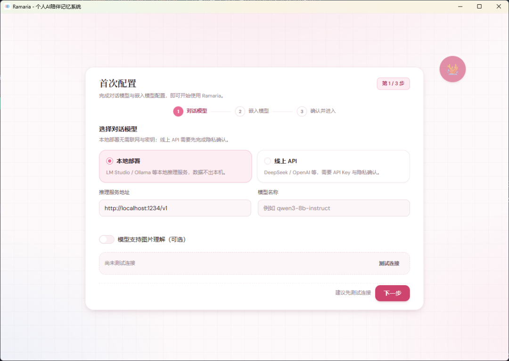
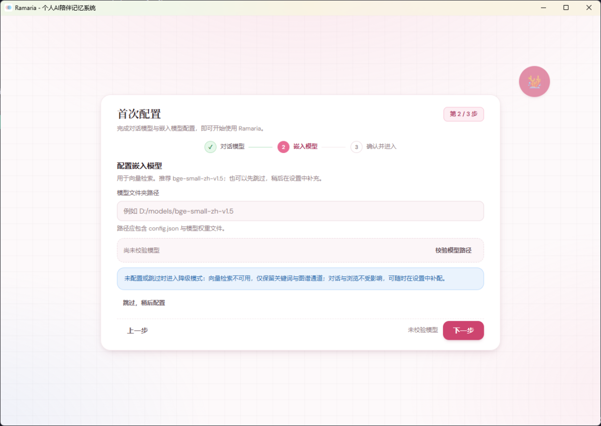
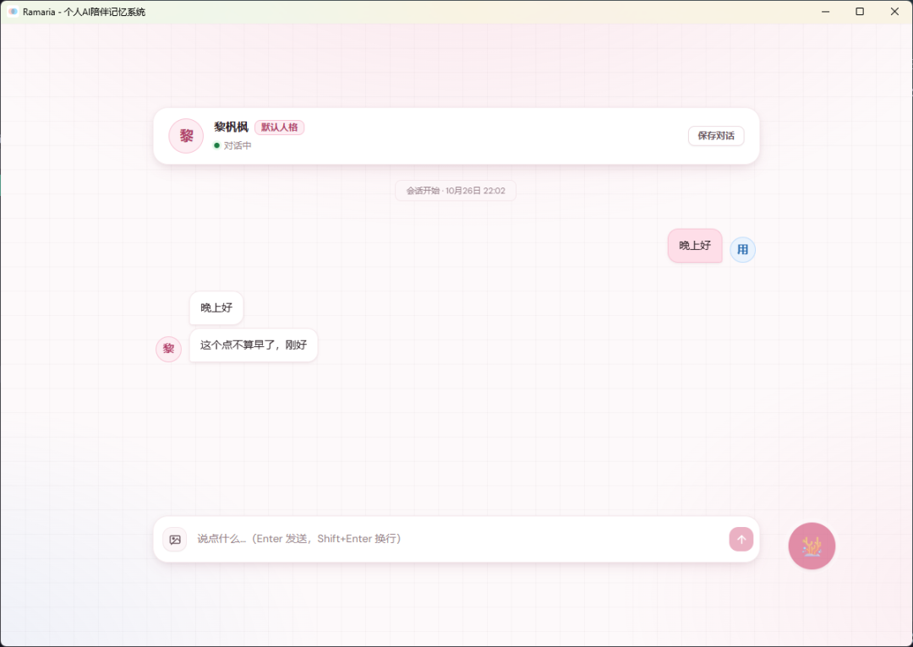
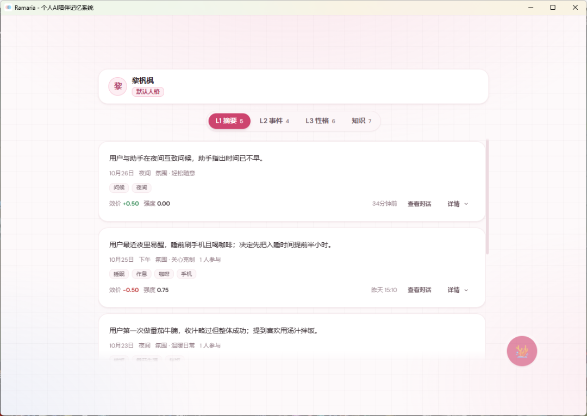
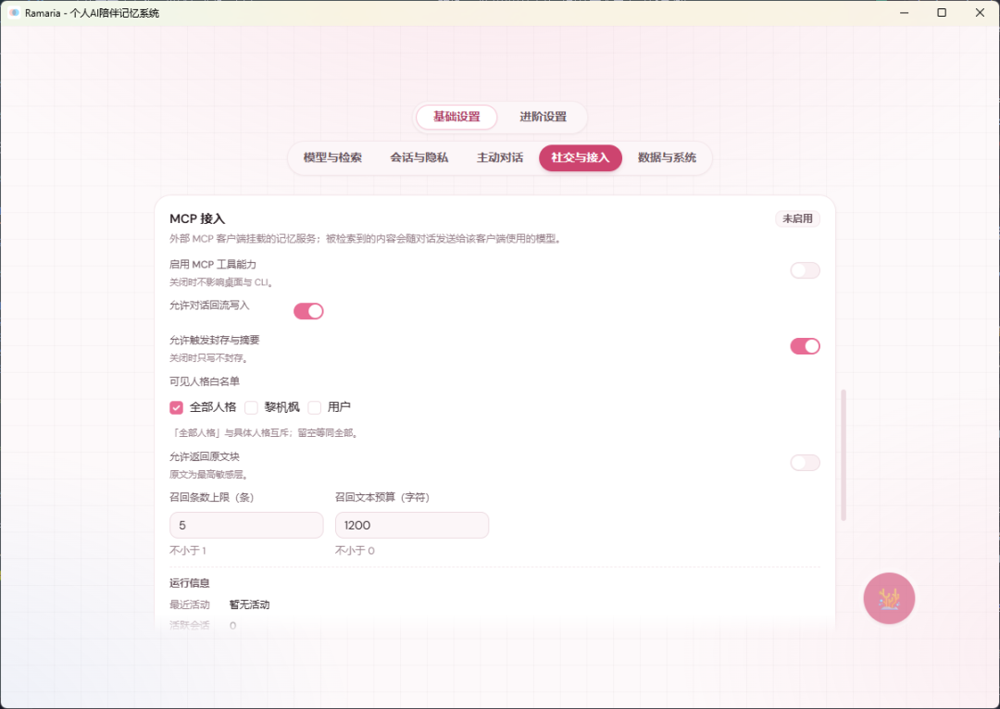
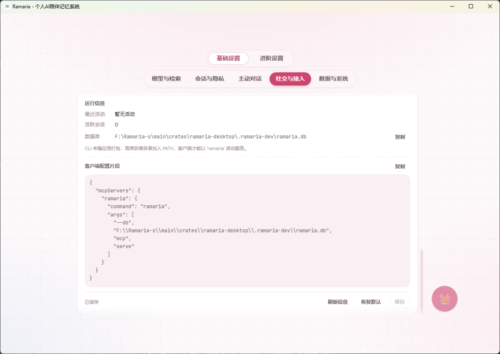
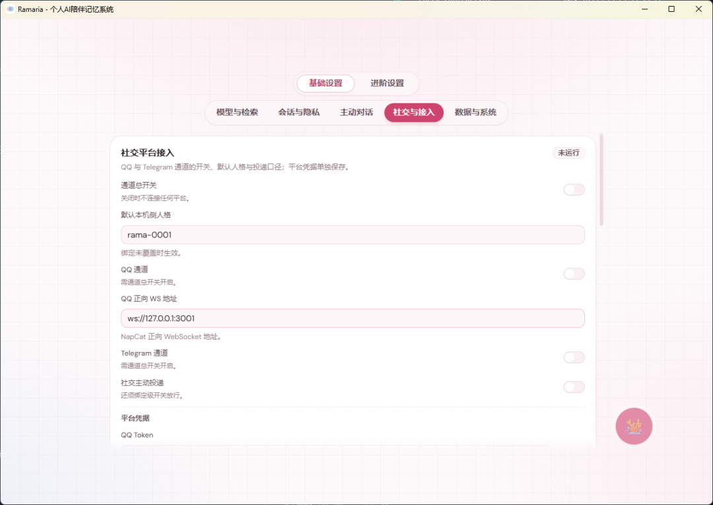

# Ramaria 新手引导（3.0）

> 版本：3.0
> 适用平台：Windows 10 1809 及以上 / Windows 11（64 位）
> 读者：第一次安装 Ramaria 的使用者
> 相关文档：[桌面使用指南](desktop-user-guide.md)、[CLI 使用指南](cli-user-guide.md)、[隐私说明](privacy-notice.md)

Ramaria（珊瑚菌）是本地优先的个人 AI 陪伴记忆系统：对话、记忆与人格都保存在本机，不采集遥测。3.0 提供三条接入路径，任选其一即可开始；三条路径共用同一份本地数据，无论从哪里说话，记忆都汇到同一处。

| 路径 | 你在哪里说话 | 适合 |
|---|---|---|
| 本地对话 | 应用内的「对话」页 | 第一次使用；不想配置外部服务 |
| MCP 接入 | 支持 MCP 的对话客户端（CodeBuddy / Trae / Claude Desktop 等） | 已有常用客户端，想让它带上你的记忆 |
| 社交接入 | QQ / Telegram | 想在聊天软件里直接对话 |

---

## 1. 安装与准备

### 1.1 系统要求

| 项目 | 要求 |
|---|---|
| 操作系统 | Windows 10 1809 及以上 / Windows 11（64 位） |
| 内存 | 8 GB 以上（本地模型越大，占用越高） |
| 磁盘 | 安装包十余 MB（以下载页为准）；嵌入模型约 100 MB（bge-small-zh-v1.5）；对话模型由 LM Studio 单独下载 |
| 运行环境 | 无需手动安装运行时；安装包内嵌 WebView2 引导程序，系统缺少 WebView2 运行时时由安装程序联网获取 |

### 1.2 选择安装包

| 包 | 适用 | 说明 |
|---|---|---|
| `Ramaria_3.0.0_x64-setup.exe` | 所有机器 | CPU 运行嵌入计算；无显卡也能用 |
| `Ramaria_3.0.0_x64-cuda-setup.exe` | 有 NVIDIA 显卡 | 需 NVIDIA 驱动与系统 CUDA 运行时；缺少时自动回退 CPU，不会崩溃 |

下载页把 CPU 包放在首位；不确定选哪个时，先用 CPU 包。

CUDA 包体积明显大于 CPU 包（内联 GPU 计算内核）。两包共用同一份数据与设置，换包直接覆盖安装，记忆不会丢失。

### 1.3 准备对话模型（二选一）

- **本地部署（推荐离线使用）**：安装 [LM Studio](https://lmstudio.ai/)，下载并加载一个中文对话模型，在 LM Studio 中启动本地服务（默认地址 `http://127.0.0.1:1234/v1`）。
- **线上 API**：准备 DeepSeek 或 OpenAI 的 API Key。首次使用线上后端时，应用会要求确认数据范围与去向。

> 只装应用不装模型也能启动，但没有可用的对话模型，发消息会失败。嵌入模型可以先跳过，之后在设置里补。
>
> 若要启用向量检索，需自备嵌入模型文件夹（默认 `bge-small-zh-v1.5` 约 100 MB）；3.0 没有应用内下载入口，可在配置向导中选择路径或跳过。

---

## 2. 路径一：本地对话

### 2.1 首次配置（三步）

首次启动进入全屏配置向导。圆键导航此时只保留「主题」与「品牌」两个键。

| 步骤 | 你要做的事 | 要点 |
|---|---|---|
| 1 对话模型 | 选「本地部署」或「线上 API」，填地址与模型名称，点「测试连接」 | 本地部署的模型名称必须与 LM Studio 中加载的模型一致；线上模式还需填 API Key |
| 2 嵌入模型 | 填模型文件夹路径，点「校验模型路径」 | 路径需包含 `config.json`、`tokenizer.json` 与权重文件（`model.safetensors`）；可点「跳过，稍后配置」，跳过只影响语义检索，不影响对话 |
| 3 确认并进入 | 核对摘要，点「保存并进入 Ramaria」 | 线上模式需先完成隐私确认；保存后直接进入对话页，不等待索引构建 |





### 2.2 说第一句话

进入应用后落在「对话」页。在底部输入框输入内容，`Enter` 发送，`Shift+Enter` 换行。

- 左侧头像即当前人格，点头像打开会话卡片；卡片顶部「新建」开新会话，底部搜索可过滤。
- 输入框左侧的图片键用于发送本地图片；所选文件必须在「发图目录」内（默认 `%APPDATA%\Ramaria\data\outgoing`，可在设置中改）。
- 助手回复按 `||` 拆成多条气泡分条显示，落库内容不变。
- 自己发出的消息在 2 分钟内可悬停「撤回」，撤回后折叠为系统提示。



### 2.3 记忆什么时候出现

记忆不是即时可见的，按下面的节奏生成：

| 层 | 何时生成 | 在哪里看 |
|---|---|---|
| L0 原文 | 消息发出即落库 | 会话卡片里的历史会话 |
| L1 摘要 | 会话结束时：空闲 10 分钟自动结束，或点右上角「保存对话」立即结束 | 记忆页「L1 摘要」 |
| L2 事件 | L1 累积到阈值后由后台提取 | 记忆页「L2 事件」 |
| L3 画像 | L2 累积到阈值后由后台推断 | 记忆页「L3 性格」 |
| 知识 | 从 L2 中抽取的稳定事实 | 记忆页「知识」 |

- 索引在后台构建，顶部横幅显示「索引构建中 N%」；构建期间可正常对话，召回暂用关键词与图谱。
- 「索引未建立」时也可以聊，只是召回范围较小；可在设置「数据与系统」里点「重建索引」。
- 记忆页顶部可切换人格；每张 L1 卡都有「查看对话」，回到对应会话。



### 2.4 会话的三种形态

| 形态 | 来源 | 能否直接输入 |
|---|---|---|
| 本地会话 | 应用内对话 | 可以 |
| 导入会话 | QQ 聊天记录导入 | 只读；要接着聊请「新建」 |
| 社交会话 | QQ / Telegram 通道 | 只读；请到对应平台回复 |

只读会话隐藏输入区，底部显示一条状态条，不提供重复入口。

### 2.5 日常使用

- **圆键导航**：核心键 🪸 展开后是「对话 / 记忆 / 人格 / 规则 / 导入」，另外三个功能键是主题（上）、设置（右）、品牌（下）。圆键可拖动，双击回到位置预设。
- **托盘与通知**：点窗口关闭键会弹出「最小化到托盘 / 退出 Ramaria」二选一；助手回复且窗口不可见时发系统通知，点击通知定位到消息。
- **人格**：人格页可改名称、描述与头像，导入 `.toml` / `.json` / `.png` 预设，或导出当前人格（默认不含真实对话示例）。
- **导入历史**：导入页支持 QQ 聊天记录，四步向导；导入的消息同样进入记忆管线。

---

## 3. 路径二：MCP 接入

### 3.1 适合谁

已有支持 MCP 的对话客户端，希望它回答时能用到你的记忆与人格，而不切换应用。

### 3.2 前置条件

1. 本机有可用的 `ramaria` 命令行。**桌面安装包不随带 CLI**：需从源码编译（`cargo build -p ramaria-cli`）或使用已有构建，并把可执行文件加入 `PATH`；没有 CLI 时客户端无法启动 MCP 服务。详见 [CLI 使用指南](cli-user-guide.md)「安装与运行」。
2. 客户端支持 MCP（stdio）。不同客户端的配置位置不同，以客户端文档为准。

### 3.3 在应用内开启

1. 打开设置 → 基础设置 →「社交与接入」→「MCP 接入」。
2. 打开「启用 MCP 工具能力」。
3. 按需收紧：可见人格白名单（默认全部可见）、允许返回原文块、允许对话回流写入、允许触发封存与摘要、召回条数上限与文本预算。
4. 在「客户端配置片段」点「复制」（片段已带上当前数据库路径）。
5. 保存本卡。





### 3.4 在客户端挂载

把复制的片段放进客户端的 MCP 配置（通常是一个 JSON 文件），保存后重启客户端或重连 MCP 连接：

```json
{
  "mcpServers": {
    "ramaria": {
      "command": "ramaria",
      "args": [
        "--db",
        "C:\\Users\\<用户名>\\AppData\\Roaming\\Ramaria\\data\\ramaria.db",
        "mcp",
        "serve"
      ]
    }
  }
}
```

- `command` 与 `--db` 以应用内片段为准：应用探测到同目录 CLI 时给绝对路径，否则给 `ramaria`（要求已在 `PATH` 中）。
- `--db` 必须是卡片「数据库」行显示的路径。MCP 客户端启动服务时的工作目录不确定，缺省 `--db` 会落到相对路径 `data/ramaria.db`，读不到桌面里的记忆。
- MCP 服务由客户端按需拉起，桌面端不常驻；「运行信息 → 最近活动 / 活跃会话」可确认是否被使用。
- 修改 `[mcp]` 配置或凭据后，需要重启客户端连接才生效。

### 3.5 验证

在客户端里问一句需要记忆的问题，例如「你还记得我们之前聊过什么吗」。能列出你导入或对话过的内容即接入成功；七个工具为 `memory_recall` / `chat_send` / `chat_ingest` / `persona_list` / `persona_get` / `chat_history` / `privacy_confirm`。

### 3.6 注意

- 被检索到的记忆会随对话发送给客户端所使用的模型；使用云端模型时，这部分内容离开本机。
- 只有打开「允许对话回流写入」，客户端里的对话才会写回本地记忆；否则只读。
- 原文块是最高敏感层，默认关闭「允许返回原文块」。

---

## 4. 路径三：社交接入

### 4.1 适合谁

想在 QQ 或 Telegram 里直接和它说话。连接随桌面应用启停：关闭应用即断开。

### 4.2 外部准备（二选一或都做）

**QQ（NapCat + OneBot v11 正向 WebSocket）**

1. 安装并登录 NapCat，按官方文档完成扫码 / 验证。
2. 打开 NapCat WebUI（默认 `http://127.0.0.1:6099`）→「网络配置」→ 新建 **WebSocket 服务器**：端口 `3001`、消息格式 `array`，保存并启用。
3. 如果该服务设置了 access token，记住它，下一步要填。

**Telegram（Bot API 长轮询）**

1. 在 Telegram 里与 [@BotFather](https://t.me/BotFather) 对话，发送 `/newbot`，按提示创建，拿到 bot token（形如 `123456789:ABC-DEF...`）。

> NapCat 等协议端是非官方第三方实现，登录 QQ 存在账号被限制的风险，请自行评估并遵守平台协议；建议使用小号、避免高频发送。Ramaria 与 NapCat 无隶属关系。

### 4.3 在应用内接入

1. 打开设置 → 基础设置 →「社交与接入」→「社交平台接入」。
2. 打开「通道总开关」，再打开要用的「QQ 通道」或「Telegram 通道」。
3. QQ 填「QQ 正向 WS 地址」（默认 `ws://127.0.0.1:3001`）；凭据在「平台凭据」里填 QQ Token 或 Telegram Bot Token，点该行「保存」。
4. 保存本卡，点卡片底部「启动」。
5. 状态显示「运行中」、平台标签显示 `online`（在线）即就绪；改动配置或凭据后需重新「停止 → 启动」。



### 4.4 放行外部会话

平台收到消息后会自动建档，但**默认不放行**：

1. 在「外部会话绑定」找到对应会话（私聊 `c2c:...` / 群聊 `group:...`）。
2. 打开该行左侧开关「启用绑定」；右侧开关是「允许主动投递」。
3. 需要指定人格时在该行下拉选择；不改则沿用通道默认人格。

未放行的会话不入库、不回复。群聊里只有 @ 它或回复它的消息才会响应。

### 4.5 在平台上使用

- 放行后，私聊直接发消息即可；回复会按 `||` 拆成多条分次发出（条间约 0.8 秒，单条最多 5 段）。
- 桌面端打开社交会话是**只读**的：可查看、可看图片，回复请到平台进行。
- 主动消息默认不在社交平台发起，需同时满足：卡片里的「社交主动投递」已打开 → 该绑定「允许主动投递」已打开 → 主动对话页该人格为开启。
- 收到的图片会先下载到本地（≤20 MB）并做一次理解（开启图片理解时）；理解超时会先按占位符回复，后台继续。

### 4.6 注意

- 凭据存入 Windows 凭据管理器，界面只显示「已配置」，不回显。
- 社交消息与本地对话同库同待遇；停用通道不会删除已入库消息。
- 使用线上模型时，消息内容与召回到的记忆会发送给模型服务；图片理解开启时图片也会外发。

---

## 5. 三条路径的时间预算

下表是首次走通的参考节奏，外部依赖（模型下载、NapCat 安装、客户端安装）另计：

| 路径 | 应用内需要做的 | 参考时长 |
|---|---|---|
| 本地对话 | 三步配置 → 第一句话 → 等一次 L1 | 10 分钟内（模型已就绪） |
| MCP 接入 | 开开关 → 复制片段 → 客户端挂载 → 验证 | 5 分钟内（CLI 与客户端已就绪） |
| 社交接入 | 填地址与凭据 → 启动 → 放行会话 | 5 分钟内（NapCat / bot 已就绪） |

---

## 6. 常见问题

**发消息没有回复，或提示「对话模型不可用」**
检查 LM Studio 是否已加载模型、地址是否为 `http://127.0.0.1:1234/v1`、模型名称是否与 LM Studio 中一致；线上模式检查 API Key 与网络。设置 →「模型与检索」可测试连接。

**顶部一直显示「索引未建立 / 索引构建中」**
索引在后台构建，不影响对话；构建完成后横幅消失。长期未完成可在设置 →「数据与系统」点「重建索引」，或确认嵌入模型已配置。

**聊过天，但记忆页是空的**
L1 在会话结束后生成：等空闲 10 分钟，或在对话页点「保存对话」。导入的历史记录需要导入流程完成摘要后才会出现。

**MCP 客户端里没有工具**
先确认 `ramaria` 命令在终端能直接运行；再确认「启用 MCP 工具能力」已打开并已保存；最后重启客户端。配置改动不会热加载。

**社交平台发了消息，机器人不回**
按顺序检查：通道总开关与对应平台开关是否打开、卡片底部是否已「启动」、该外部会话的「启用绑定」是否已放行、群聊是否 @ 了它。

**社交会话不能输入**
这是有意设计：社交通道会话在桌面只读，回复请到 QQ / Telegram。

**卸载后数据还在吗**
卸载程序不删除 `%APPDATA%\Ramaria`（对话、记忆、配置都在这里）。需要彻底清理时，先导出需要的内容，再手动删除该目录。

---

## 7. 数据与隐私

| 项 | 位置 / 说明 |
|---|---|
| 数据库 | `%APPDATA%\Ramaria\data\ramaria.db` |
| 配置 | `%APPDATA%\Ramaria\data\config.toml` |
| 日志 | `%APPDATA%\Ramaria\data\logs\`（不含消息原文与 API Key） |
| API Key / 平台凭据 | Windows 凭据管理器，不写入配置文件 |
| 遥测 | 无；不联网也能使用（本地模型 + 本地嵌入） |

3.0 与 2.x 的数据目录不通用：2.x 的 `assistant.db` 不会被读取，也不会被删除。详细口径见[隐私说明](privacy-notice.md)。

---

## 8. 接下来

- 想调参数：设置 →「进阶设置」（需在品牌浮层打开「显示调试视图与进阶设置」）。
- 想批量导入历史：导入页支持 QQ 聊天记录，完成后可「继续处理」补齐附件与摘要。
- 想接入更多平台或排查问题：见[桌面使用指南](desktop-user-guide.md)与[CLI 使用指南](cli-user-guide.md)。
